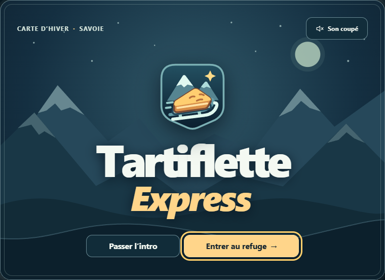
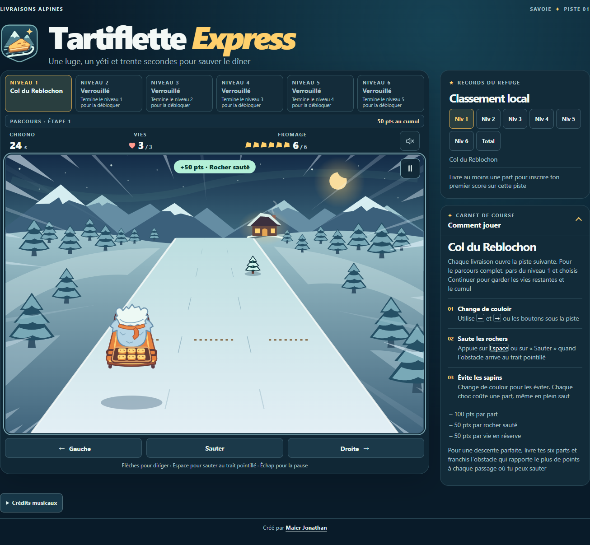

# Tartiflette Express

**[Jouer dans le navigateur](https://john7440.github.io/tartiflette-express-pages/)**

Une luge, de la neige et une tartiflette à livrer au refuge

Ce jeu réalisé avec React propose neuf pistes à découvrir et trois vies pour aller jusqu’au bout

## Prends les commandes

- Flèches gauche et droite pour changer de couloir
- Espace pour sauter au repère pointillé
- Échap pour mettre en pause et reprendre
- Boutons tactiles sous la piste pour jouer sur mobile
- Bouton de son pour activer ou couper la musique et les bruitages

Livre tes parts et réussis des sauts pour cumuler les points jusqu’à la perte des trois vies ou l’arrivée au bout de la neuvième piste

Les classements locaux conservent les cinq meilleurs scores dans ton navigateur

Consulte les [crédits musicaux](CREDITS.md)

Créé par Maier Jonathan · [GitHub](https://github.com/john7440)
